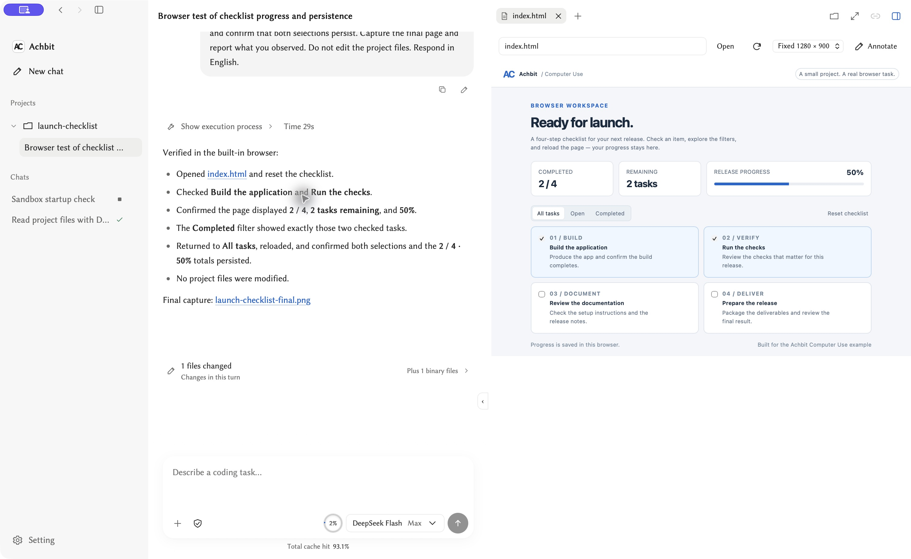

[English](./achbit.md) | [简体中文](./achbit.zh-CN.md) · [← Back](../README.md)

# Use DeepSeek with Achbit

[Achbit](https://github.com/Achbite/Achbit) is an MIT-licensed, local-first coding agent with a desktop GUI, TUI, and CLI. This guide uses **Achbit 0.6.60** and **DeepSeek Flash** through the **Responses API**.

Achbit connects project editing, command execution, browser interaction, and visual inspection in the same conversation. Its GUI, TUI, and CLI share model connections and Session state. Computer Use adds an embedded browser, an optional Chrome DevTools MCP connection, and authorized native desktop interaction on macOS and Windows.

## 1. Install and open Achbit

Download a package for your platform from [Achbit 0.6.60](https://github.com/Achbite/Achbit/releases/tag/0.6.60).

| Platform | Installer or archive | GUI entry |
| --- | --- | --- |
| macOS Apple Silicon | `Achbit-0.6.60-macos-arm64.pkg` or `Achbit-0.6.60-macos-arm64.tar.gz` | `/Applications/Achbit.app`, or `Achbit.app` in the portable directory |
| Windows x64 | `Achbit-0.6.60-win64-setup.exe` or `Achbit-0.6.60-win64.zip` | Start menu, or portable `Achbit.exe` |
| Linux ARM64 | `Achbit-0.6.60-linux-arm64.tar.gz` | `./Achbit` in the extracted directory |

Packages include their runtime. Windows portable GUI requires WebView2; Linux GUI requires GTK, WebKitGTK, and ALSA. macOS packages use the project's local development signing identity and are not Apple-notarized. See [installation and user directories](https://github.com/Achbite/Achbit/blob/0.6.60/docs/distribution.md).

For a source build, install Docker and GNU Make; on Windows use WSL2 with Docker integration. macOS packaging also requires Xcode Command Line Tools, the repository's Rust toolchain, and Node.js on the host.

On the host:

```sh
git clone --branch 0.6.60 https://github.com/Achbite/Achbit.git Achbit
cd Achbit
# macOS only, once before packaging:
bash scripts/setup-macos-signing.sh
make shell
```

Skip the signing command on Windows and Linux. Inside the development container, run `bash ./build.sh` to update the current host's runnable product, or choose `bash ./build.sh --stage package-macos`, `--stage package-windows`, or `--stage package-linux` for a distribution package. Leave the container and launch the output on its target host. See the [build guide](https://github.com/Achbite/Achbit/blob/0.6.60/README.md#build-from-source).

## 2. Save a DeepSeek connection and model

Get an API key from the [DeepSeek Platform](https://platform.deepseek.com/).

1. Open **Settings → Models & services → API connections**.
2. Open the **DeepSeek** connection, or add an API connection with DeepSeek as the service.
3. Set the API address to `https://api.deepseek.com`, enter your key, and save.
4. Open or add its model and save the following settings:

| Setting | Value |
| --- | --- |
| Display name | `DeepSeek Flash` |
| Model | `deepseek-flash` |
| API protocol | Responses API |
| Context window | `1000000` |
| Maximum output | `384000` |
| Thinking | Enabled |
| Reasoning effort | `max` |
| Image input | Enabled |
| Web search | Off |

Use `deepseek-flash` as the API model name. See [DeepSeek's model documentation](https://api-docs.deepseek.com/quick_start/pricing/) for current capabilities and pricing.

DeepSeek documents a 1M context window and up to 384K output tokens. The output setting is a maximum budget, not a requested answer length. Select `max` in the conversation too if an earlier conversation effort overrides the saved model profile. Image input is needed for screenshot-based work. The model editor's Web search switch controls the provider-hosted Responses tool, which Flash ignores; Achbit's own search tools have separate availability. See [Responses API](https://api-docs.deepseek.com/guides/responses_api/) and [Thinking Mode](https://api-docs.deepseek.com/guides/thinking_mode/).

## 3. Run a first task and continue the conversation

Select a project and the saved DeepSeek model. Send:

> Read this project's README. Explain its purpose, entry points, and how to run it. Cite the files you actually read. Do not modify files.

Then, in the same conversation:

> Read one source file related to the entry point you identified. Explain how it connects to the README, with a short excerpt. Do not modify files.

Review any access requests and inspect the actual tool results. Then try the [Launch checklist Computer Use project](https://github.com/Achbite/Achbit/tree/0.6.60/examples/launch-checklist): open its folder as a project and use the supplied prompt. The agent opens the local HTML, checks two tasks, verifies **2 / 4 and 50%**, filters completed items, and reloads to check persistence. The example needs no server or dependencies.



The project includes a [run summary](https://github.com/Achbite/Achbit/blob/0.6.60/examples/launch-checklist/run-summary.json) and browser capture. For a task that also researches a public page and creates a deliverable, see the [browser research example](https://github.com/Achbite/Achbit/tree/0.6.60/examples/deepseek-browser-checklist).

## 4. Use the same connection from CLI or TUI

After macOS PKG or Windows Setup installation, use `achbit-cli` and `achbit-tui`. Reopen the Windows terminal after installation. Portable packages provide these launchers:

| Platform | CLI | TUI |
| --- | --- | --- |
| macOS | `./Achbit-CLI.command` | `./Achbit-TUI.command` |
| Windows | `.\achbit-cli.bat` | `.\achbit-tui.bat` |
| Linux | `./achbit-cli` | `./achbit-tui` |

```sh
achbit-cli connections
achbit-cli --model <profile-id> chat -C /path/to/project
achbit-tui -C /path/to/project
```

Replace the command with the portable launcher when needed. Copy `<profile-id>` from `connections`: it identifies the saved configuration, not the API model name. In TUI use `/model` to select it, `/sessions` and `/resume` to continue a conversation, and `/language en-US` or `/language zh-CN` for interface language.

## How Computer Use and the agent loop fit together

- **One conversation across work surfaces.** Session owns model turns, context, waiting, cancellation, and the durable conversation journal. GUI, TUI, and CLI consume its shared projection, so a tool result remains part of the same task when the user changes interface.
- **Tools added when needed.** Core file, command, and web tools are complemented by discoverable plugins. Activation contributes the selected tools and their guidance to the current run; CLI, MCP, and Computer Use use the existing execution and permission path. Tools are chosen for the operation: programmatic work can use CLI/MCP, with GUI interaction for interface behavior and visual checks.
- **Execution facts drive continuation.** The Kernel executes tools and records results. File calls use bounded parallel execution where their dependency information permits it. Long commands retain their running state; dependent steps wait for actual completion. Waiting, cancellation, errors, and unknown outcomes remain distinguishable.
- **Observation and input are explicit.** Native actions use observations tied to the actual app/window/run. Observation defaults to background; mouse and keyboard input require explicit foreground observation. A dispatched action followed by an observation failure remains a dispatched action, preventing a screenshot failure from being mistaken for permission to repeat the input.

Implementation: [Session loop](https://github.com/Achbite/Achbit/blob/0.6.60/userspace/session-core/src/local-agent/loop.ts), [tool catalog](https://github.com/Achbite/Achbit/blob/0.6.60/crates/achbit-kernel-daemon/src/local_agent_tool_catalog.rs), and [Computer Use documentation](https://github.com/Achbite/Achbit/blob/0.6.60/plugins/computer-use/README.md).

The embedded browser requires an originating GUI window. Native desktop tools use the shared Host and are available to CLI/TUI/GUI when supported and permitted. macOS native desktop control requires macOS 15.2+, Accessibility, and Screen Recording; Windows rejects elevated app windows from a normal session. Linux supports the embedded browser's non-screenshot page operations, but not native desktop control or browser screenshot tools. [Chrome integration](https://github.com/Achbite/Achbit/blob/0.6.60/plugins/chrome-devtools/README.md) has its own browser consent flow. Plugin activation does not grant execution or OS permissions.

## References

- [Achbit DeepSeek guide](https://github.com/Achbite/Achbit/blob/0.6.60/docs/product/deepseek.md)
- [Computer Use example project](https://github.com/Achbite/Achbit/tree/0.6.60/examples/launch-checklist)
- [DeepSeek Responses API](https://api-docs.deepseek.com/guides/responses_api/)
- [DeepSeek Thinking Mode](https://api-docs.deepseek.com/guides/thinking_mode/)
- [Current models and prices](https://api-docs.deepseek.com/quick_start/pricing/)
