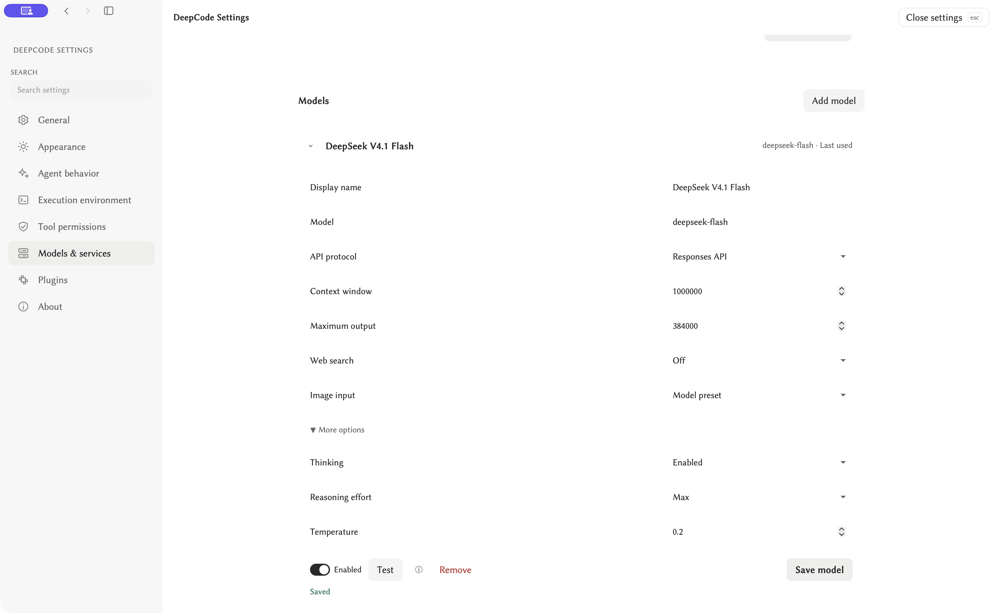
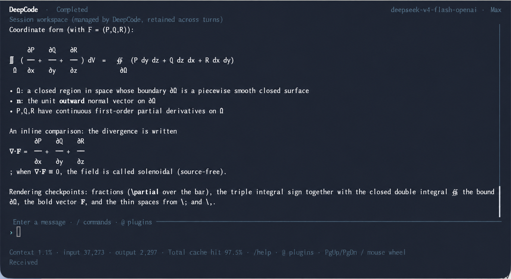

[English](./achbite_deepcode.md) | [简体中文](./achbite_deepcode.zh-CN.md) · [← Back](../README.md)

# Use DeepSeek with DeepCode (Achbite)

[DeepCode](https://github.com/Achbite/DeepCode) is an MIT-licensed, local-first coding agent with GUI, TUI, and CLI interfaces. This guide connects **DeepSeek V4.1 Flash** through the **Responses API** to read a project, run tools, and continue the conversation.

Alongside project files and shell tools, **Computer Use** lets the agent work with visual interfaces: the GUI has an embedded browser for frontend previews and inspection, and can connect to Chrome or operate native macOS and Windows applications with authorization. The embedded preview requires the GUI; available tools and permissions depend on the platform. See [Computer Use](https://github.com/Achbite/DeepCode/blob/0.6.50/plugins/computer-use/README.md) and [Chrome integration](https://github.com/Achbite/DeepCode/blob/0.6.50/plugins/chrome-devtools/README.md).

## 1. Install and open DeepCode

[DeepCode 0.6.50](https://github.com/Achbite/DeepCode/releases/tag/0.6.50) provides macOS Apple Silicon packages with the runtime included:

- **Installer:** download [DeepCode-0.6.50-macos-arm64.pkg](https://github.com/Achbite/DeepCode/releases/download/0.6.50/DeepCode-0.6.50-macos-arm64.pkg), install it, and open `/Applications/DeepCode-GUI.app`.
- **Portable archive:** download [DeepCode-0.6.50-macos-arm64.tar.gz](https://github.com/Achbite/DeepCode/releases/download/0.6.50/DeepCode-0.6.50-macos-arm64.tar.gz), extract it, and open `macos-arm64/DeepCode-GUI.app`. Its terminal launchers are `./DeepCode-CLI.command` and `./DeepCode-TUI.command` inside `macos-arm64`.

Read the release's signing and first-open notes before installation. This release uses the project's local development signing identity and is not Apple-notarized.

For a source build, install Docker and GNU Make; Windows uses WSL2 with Docker integration. macOS packaging also requires Xcode Command Line Tools, the repository's Rust toolchain, and Node.js on the Mac host.

**On the host:**

```bash
git clone --branch 0.6.50 https://github.com/Achbite/DeepCode.git
cd DeepCode
# macOS only, once before packaging; skip on Windows and Linux:
bash scripts/setup-macos-signing.sh
make shell
```

`make shell` builds or updates the development image, creates or reuses the checkout's container, and enters it. On macOS it also starts the native build bridge. **Inside the container**, choose the target:

| Target | Build command | Output |
| --- | --- | --- |
| macOS Apple Silicon | `bash ./build.sh --stage package-macos` | `bin/macos-arm64/` |
| Windows x64 | `bash ./build.sh --stage package-windows` | `bin/win64/` |
| Linux, matching the container architecture | `bash ./build.sh --stage package-linux` | `bin/linux-x64/` or `bin/linux-arm64/` |

After a successful build, run `exit`. **Back on the target host**, open `bin/macos-arm64/DeepCode-GUI.app` on macOS, `bin/win64/DeepCode-GUI.exe` on Windows, or `./DeepCode-GUI` inside the Linux output directory. Windows portable packages require WebView2; Linux GUI requires GTK/WebKitGTK. See [platform installation details](https://github.com/Achbite/DeepCode/blob/0.6.50/docs/distribution.md) and [build instructions](https://github.com/Achbite/DeepCode/blob/0.6.50/README.md#build-from-source).

## 2. Save a DeepSeek connection and model

Get an API key from the [DeepSeek Platform](https://platform.deepseek.com/).

1. Open **Settings → Models & services → API connections**.
2. Open the existing **DeepSeek** connection. If absent, choose **Add connection → API connection** and select **DeepSeek** as the service.
3. Set the API address to `https://api.deepseek.com`, enter your API key, and save.
4. Open its model, or choose **Add model**, enter these settings, and click **Save model**:

| Setting | Value |
| --- | --- |
| Display name | `DeepSeek V4.1 Flash` |
| Model | `deepseek-flash` |
| API protocol | Responses API |
| Context window | `1000000` |
| Maximum output | `384000` |
| More options → Thinking | Enabled |
| More options → Reasoning effort | `max` |
| Web search | Off |

Use `deepseek-flash` as the API model name, following the [current DeepSeek model documentation](https://api-docs.deepseek.com/quick_start/pricing/). `DeepSeek V4.1 Flash` is the display label. Some integration examples still use `deepseek-v4-flash`; use the current API name above for this setup.

DeepSeek documents a **1M-token context window** and **up to 384K output tokens**. The settings above are DeepCode's token budgets. Context includes both input and generated output, and a maximum output budget does not request that many output tokens. Keep Thinking enabled and explicitly save `max`; the built-in preset does not itself fix the effort to `max`. See [Thinking Mode](https://api-docs.deepseek.com/guides/thinking_mode/).

For `deepseek-flash`, the [Responses API](https://api-docs.deepseek.com/guides/responses_api/) ignores the built-in `web_search` tool, so leave it off in this Flash setup. The same API documents server-side web search for `deepseek-v4-pro`; that is a different model path. Separately configured web-search tools have their own availability.



*The saved settings in the macOS GUI. The screenshot contains no API key.*

The model editor's **Test** action sends a short connection probe and uses API quota. A successful probe confirms that request; continue with a real task below.

## 3. Run a first task, then continue

Select your project folder and the saved DeepSeek model in the conversation's model selector. Select **`max`** there as well: an explicit conversation effort takes precedence over the model profile, and DeepCode remembers that choice for the model.

Send:

> Read this project's README and explain its purpose, entry points, and how to run it. Cite the files you actually read. Do not modify files.

Then send a second message in the same conversation:

> Read one source file related to the entry point you identified. Explain how it connects to the README, with a short code excerpt and a table. Do not modify files.

Review any access requests shown by DeepCode. The execution history shows which tools ran and what they returned. Keep the same conversation for the second message so the agent can use the first task's context.

## 4. Use the connection in CLI or TUI

GUI, CLI, and TUI share saved model connections. After installing with the macOS PKG or Windows Setup, use `deepcode-cli` and `deepcode-tui`; reopen the Windows terminal to load the updated PATH. For the macOS portable archive, replace these names with `./DeepCode-CLI.command` and `./DeepCode-TUI.command`. Windows source builds provide `.\deepcode-cli.bat` and `.\deepcode-tui.bat`; Linux source builds provide `./deepcode-cli` and `./deepcode-tui`.

```bash
deepcode-cli connections
deepcode-cli --model <profile-id> chat -C /path/to/project
```

Copy `<profile-id>` from the DeepSeek model shown by `connections`. It is the saved DeepCode configuration ID, not the API name `deepseek-flash`. Send both prompts in this CLI chat and use `/quit` when finished.

For TUI:

```bash
deepcode-tui -C /path/to/project
```

Use `/model` to choose the saved DeepSeek model, or `/model <profile-id>` to select it directly. Its saved `max` profile setting applies when the conversation has no explicit effort override. Use `/sessions` and `/resume` to reopen an existing conversation, and `/` to see available commands. See [terminal window and font behavior](https://github.com/Achbite/DeepCode/blob/0.6.50/docs/distribution.md).

Use `/language en-US` or `/language zh-CN` to change the TUI interface language immediately and save the shared preference. Asking the model to answer in English changes its reply, not the interface. You can also start with `deepcode-tui --language en-US` to override the saved language for that launch.



*English documentation illustration based on the maintainer's real TUI screenshot, with interface labels translated using image editing. See the [unedited native screenshot](assets/achbite-deepcode-tui.png). These images illustrate the interface; the header shows a saved profile ID, not the API model name.*

## References

- [DeepCode models, connections, and usage](https://github.com/Achbite/DeepCode/blob/0.6.50/docs/product/model-services.md)
- [DeepSeek Responses API](https://api-docs.deepseek.com/guides/responses_api/)
- [DeepSeek Thinking Mode](https://api-docs.deepseek.com/guides/thinking_mode/)
- [Current models and prices](https://api-docs.deepseek.com/quick_start/pricing/)
